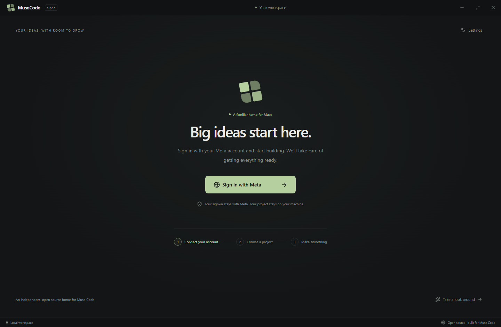

# MuseCode

A comfortable, open source desktop home for Meta's Muse Code agent. An independent community project; not affiliated with or endorsed by Meta.



MuseCode takes the approach used in the local Grok Build desktop app: put a GUI around the real agent runtime. It uses Meta's official `@muse-code/sdk` and `muse serve`, rather than reimplementing the coding loop or calling a model as a basic chatbot. The UI is newly written; no Grok source, branding, credentials, or agent binary is redistributed.

## Run the Windows build

Download the Windows installer from the [alpha release](https://github.com/Suolaraketti/musecode-desktop/releases/tag/v0.2.0-alpha.1). It is an unsigned development alpha; live Muse/Wonder sessions still need validation.

For a locally packaged build, open `release/win-unpacked/MuseCode.exe` and keep the other files in that directory next to it. `npm run dist` also generates `release/MuseCode Setup 0.2.0.exe`.

To run from source, install Node.js 22 or newer:

```sh
git clone https://github.com/Suolaraketti/musecode-desktop.git
cd musecode-desktop
npm ci
npm start
```

For a frontend-only preview:

```sh
npm run dev
```

Then open `http://127.0.0.1:5173`. Browser preview has no filesystem or process access. Use Take a look around for a clearly labeled, offline sample conversation.

## Get started

1. Download and open MuseCode on Windows.
2. Click **Sign in with Meta**. MuseCode detects an existing Muse runtime or downloads the official runtime into its private app-data directory automatically. No separate terminal, PATH editing, or executable picker is required.
3. Complete Meta's sign-in in your browser and confirm the displayed code. The app returns to your workspace when the native host confirms the account.
4. Open your project and start a conversation. Available models are loaded from your actual Muse account before the first prompt; Wonder/Full appear when offered by the runtime.

Returning users reconnect automatically. MuseCode restores the last project, native conversation, and unsent draft. A second app launch focuses the existing window. Connection failures trigger bounded reconnect attempts without resubmitting prompts. Expired or denied sign-ins show a recovery action.

Runtime update checks run once per day in the background for app-managed installations; a downloaded update is used on the next connection. The main interface contains account and appearance settings. Custom executable selection is available under **Settings → Advanced connection settings** for developers.

Automatic installation currently targets Windows. Existing native Muse installations can be connected on other platforms through Advanced settings. Meta controls account access, runtime download availability, and model entitlement. The runtime is downloaded from Meta and is not redistributed in our installer.

Account status and browser sign-in use the host-owned experimental MSP `account/*` methods negotiated at initialization. Muse owns credential storage, OAuth polling, cancellation and refresh. The GUI never receives access or refresh tokens, and does not fabricate a successful login from a transport connection.

## Implemented in this alpha

- Guided first run, automatic Windows runtime setup, native Meta browser sign-in, background runtime updates, and recovery.
- Project picker, recent projects, saved native sessions, new conversations, session resume, and last-workspace/draft restoration.
- Streamed Markdown conversations, tool calls, reasoning, subagent/workflow items, and generic rendering for additional item kinds.
- Follow-up steering while running; Alt+Enter queues the prompt; stop sends native cancellation.
- Model selection from `model/list` and reasoning effort on each submitted turn.
- Explicit approvals using only server-offered choices and the current approval stage.
- Agent questions with single or multiple selection and free-text answers.
- Rename, fork, compact, and export conversations.
- Local file browser and bounded text previews; Git status and staged/unstaged/untracked diff inspection.
- Skills, plugins, hooks, and task inventories through the session protocol.
- Native user-shell commands when the server grants `userShell`.
- Context usage and agent plan inspection when the runtime emits them.
- Dark/light themes, command palette, familiar window controls, offline interface preview.

Native permissions and sandbox settings remain owned by Muse Code. No permissive launch flags are added. The GUI does not claim an approval policy different from the runtime's policy.

## Remaining work before a public release

This is a working foundation, not yet full TUI parity or a production release. Fresh runtime installation and native initialization, account status, and browser-login start/cancel were validated with Muse 1.4.6. Completed account authorization and live Wonder coding still need testing with a user account. Automated desktop tests use a deterministic MSP host for completed login and coding interactions.

| Surface | Current state | Next work |
| --- | --- | --- |
| Authentication | Automatic setup and native browser sign-in | Complete user-account authorization and live Wonder validation |
| Models | Native catalog and session switch | Validate Wonder/Full entitlement and effort variants live |
| Agent activity | Renders native items | Rich workflow timelines and subagent controls |
| Files/Git | Read-only previews and diffs | Editor, staged review/commit flow, worktrees |
| Context | Native usage, compaction and plan inspection | Goals, rewind, memory and queued-turn management |
| Extensions | Read-only inventories | Native capability-gated editing and installation |
| Input | Text and structured answers | Image/file uploads and supported voice input |
| Terminal | Native session shell capability | Output paging and richer terminal presentation |
| Distribution | Windows development build | Signed installers, macOS/Linux QA, updater |
| Accessibility | Labels, keyboard entry, reduced motion | Full focus trapping, screen-reader and keyboard audit |

Session listings are currently capped at 100 entries; projects at 20. File previews are limited to 1 MB. There is no telemetry or hosted proxy in this implementation. The agent itself follows its configured data policies. Browser-only preview cannot send prompts or access local projects.

## Architecture

```text
React renderer (sandboxed, no Node access)
    → narrow contextBridge API
Electron main process
    → official @muse-code/sdk NDJSON transport
    → muse serve
    → Meta's coding agent, existing auth, tools, permissions and models

Electron main process
    → confined filesystem previews + read-only Git commands
```

The main process owns the child lifetime, session folds, approval stage validation, file boundaries, and native dialogs. The SDK owns wire framing, UUIDv7 command IDs, and session event folding. Provisional deltas are rendered while items are in progress; final full revisions replace them. User turn submissions are not automatically retried after an ambiguous failure.

Read-only project operations resolve real paths and reject traversal/symlink escapes. Git commands use argument arrays, never a shell string. The renderer receives a fixed IPC method list. External links open only over HTTPS; remote page navigation and new renderer windows are blocked.

## Development and validation

```sh
npm run check         # TypeScript renderer
npm test              # MSP transport, approval, resume, files and Git tests
npm run test:desktop  # Build and run two Electron UI acceptance tests
npm run test:native -- /path/to/muse # Opt-in native handshake/login start-cancel (no model call)
npm run package       # Unpacked desktop build for the host OS
npm run dist          # Installer (signing must be configured for release)
npm audit
```

The desktop tests launch hidden windows and use isolated temporary profiles/projects. They verify onboarding, native sign-in rendering, approvals, project selection, session/draft restoration, preview labels, themes, command palette, file/Git IPC, and advanced-setting errors. Completed authorization is simulated by the test host. Reference screenshots are generated by source tests; macOS/Linux builds and live Wonder sessions still need independent validation.

For frontend hot reload, run `npm run dev`, then launch Electron with `MUSECODE_DEV_URL=http://127.0.0.1:5173`. Only that exact loopback development URL is accepted.

## Contributing

Start with a small issue describing a concrete user problem. Keep native agent semantics in the protocol bridge, keep credentials out of the renderer and repository, and add meaningful transport or boundary tests when changing those paths. Use capability discovery before introducing controls that a host may not support. Run the checks above before a pull request.

## References and license

- [Official Meta Muse Code documentation](https://dev.meta.ai/docs/muse-code)
- [Official Muse Code SDK source](https://github.com/meta-models/muse-code-sdk)
- [Official SDK reference](https://meta-models.github.io/muse-code-sdk/)

MuseCode's source is MIT licensed. Third-party dependencies retain their own licenses. The Meta Muse Code runtime is installed separately and is not included in this distribution.
