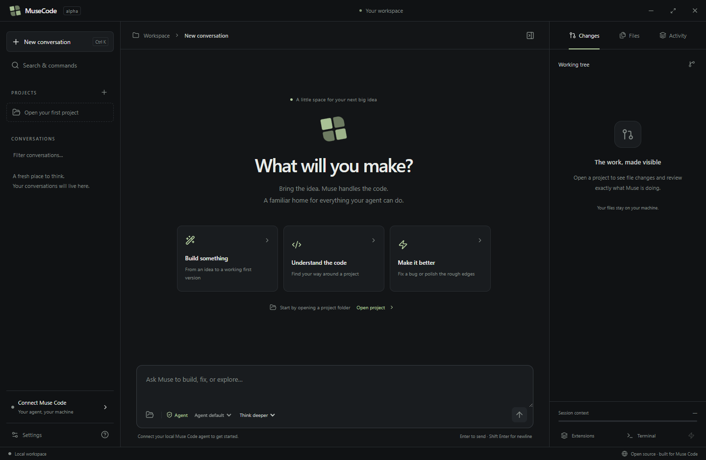

# MuseCode

A comfortable, open source desktop home for Meta's Muse Code agent. An independent community project; not affiliated with or endorsed by Meta.



MuseCode takes the approach used in the local Grok Build desktop app: put a GUI around the real agent runtime. It uses Meta's official `@muse-code/sdk` and `muse serve`, rather than reimplementing the coding loop or calling a model as a basic chatbot. The UI is newly written; no Grok source, branding, credentials, or agent binary is redistributed.

## Run the Windows build

Download the Windows installer from the [alpha release](https://github.com/Suolaraketti/musecode-desktop/releases/tag/v0.1.0-alpha.1). It is an unsigned development alpha; live Muse/Wonder sessions still need validation.

For a locally packaged build, open `release/win-unpacked/MuseCode.exe` and keep the other files in that directory next to it. `npm run dist` also generates `release/MuseCode Setup 0.1.0.exe`.

To run from source, install Node.js 22 or newer:

```sh
git clone https://github.com/Suolaraketti/musecode-desktop.git
cd musecode-desktop
npm ci
npm start
```

For a frontend-only preview:

```sh
npm run dev
```

Then open `http://127.0.0.1:5173`. Browser preview has no filesystem or process access. Use Settings → Explore the interface for a clearly labeled, offline sample conversation.

## Connect Meta Muse Code

1. Install the official Muse Code CLI using [Meta's instructions](https://dev.meta.ai/docs/muse-code).
2. Start `muse` once to sign in with your Meta account and configure your native permission policy. The GUI shares the CLI's environment, configuration, and authentication. MuseCode does not collect API keys.
3. In MuseCode, open Settings. Select the native `muse` executable on macOS/Linux, or `muse-bin-<version>.exe` on Windows. Shell launchers such as `.cmd` and `.ps1` are not supported.
4. Connect the agent and open a project folder.
5. Send a prompt. The model selector uses the agent's actual model catalog; Wonder and Wonder Full appear only when your connected runtime/account exposes them. No model identifiers or subscription entitlements are guessed.

The CLI installer may have access restrictions. Those are controlled by Meta; MuseCode does not bypass them. Native binaries can also be selected from an existing CLI installation.

## Implemented in this alpha

- Project picker, recent projects, saved native sessions, new conversations, and session resume.
- Streamed Markdown conversations, tool calls, reasoning, subagent/workflow items, and generic rendering for additional item kinds.
- Follow-up steering while running; Alt+Enter queues the prompt; stop sends native cancellation.
- Model selection from `model/list` and reasoning effort on each submitted turn.
- Explicit approvals using only server-offered choices and the current approval stage.
- Agent questions with single or multiple selection and free-text answers.
- Rename, fork, compact, and export conversations.
- Local file browser and bounded text previews; Git status and staged/unstaged/untracked diff inspection.
- Skills, plugins, hooks, and task inventories through the session protocol.
- Native user-shell commands when the server grants `userShell`.
- Context usage and agent plan inspection when the runtime emits them.
- Dark/light themes, command palette, familiar window controls, offline interface preview.

Native permissions and sandbox settings remain owned by Muse Code. No permissive launch flags are added. The GUI does not claim an approval policy different from the runtime's policy.

## Remaining work before a public release

This is a working foundation, not yet full TUI parity or a production release. Live Meta authentication/model runs have not been validated on this machine because the Muse CLI was not installed. Transport integration is tested against a deterministic MSP fixture, not a real Wonder model.

| Surface | Current state | Next work |
| --- | --- | --- |
| Authentication | Reuses CLI sign-in | GUI onboarding and installation detection improvements |
| Models | Native catalog and session switch | Validate Wonder/Full entitlement and effort variants live |
| Agent activity | Renders native items | Rich workflow timelines and subagent controls |
| Files/Git | Read-only previews and diffs | Editor, staged review/commit flow, worktrees |
| Context | Native usage, compaction and plan inspection | Goals, rewind, memory and queued-turn management |
| Extensions | Read-only inventories | Native capability-gated editing and installation |
| Input | Text and structured answers | Image/file uploads and supported voice input |
| Terminal | Native session shell capability | Output paging and richer terminal presentation |
| Distribution | Windows development build | Signed installers, macOS/Linux QA, updater |
| Accessibility | Labels, keyboard entry, reduced motion | Full focus trapping, screen-reader and keyboard audit |

Session listings are currently capped at 100 entries; projects at 20. File previews are limited to 1 MB. There is no telemetry or hosted proxy in this implementation. The agent itself follows its configured data policies. Browser-only preview cannot send prompts or access local projects.

## Architecture

```text
React renderer (sandboxed, no Node access)
    → narrow contextBridge API
Electron main process
    → official @muse-code/sdk NDJSON transport
    → muse serve
    → Meta's coding agent, existing auth, tools, permissions and models

Electron main process
    → confined filesystem previews + read-only Git commands
```

The main process owns the child lifetime, session folds, approval stage validation, file boundaries, and native dialogs. The SDK owns wire framing, UUIDv7 command IDs, and session event folding. Provisional deltas are rendered while items are in progress; final full revisions replace them. User turn submissions are not automatically retried after an ambiguous failure.

Read-only project operations resolve real paths and reject traversal/symlink escapes. Git commands use argument arrays, never a shell string. The renderer receives a fixed IPC method list. External links open only over HTTPS; remote page navigation and new renderer windows are blocked.

## Development and validation

```sh
npm run check         # TypeScript renderer
npm test              # MSP transport, approval, resume, files and Git tests
npm run test:desktop  # Build and run real Electron UI acceptance test
npm run package       # Unpacked desktop build for the host OS
npm run dist          # Installer (signing must be configured for release)
npm audit
```

The desktop test launches a hidden window and uses an isolated temporary app profile/project. It verifies onboarding, preview labels, themes, command palette, native picker/IPC, file previews, Git diffs, and missing-binary errors. It generates reference screenshots. macOS/Linux builds and authenticated Muse sessions still need independent validation.

For frontend hot reload, run `npm run dev`, then launch Electron with `MUSECODE_DEV_URL=http://127.0.0.1:5173`. Only that exact loopback development URL is accepted.

## Contributing

Start with a small issue describing a concrete user problem. Keep native agent semantics in the protocol bridge, keep credentials out of the renderer and repository, and add meaningful transport or boundary tests when changing those paths. Use capability discovery before introducing controls that a host may not support. Run the checks above before a pull request.

## References and license

- [Official Meta Muse Code documentation](https://dev.meta.ai/docs/muse-code)
- [Official Muse Code SDK source](https://github.com/meta-models/muse-code-sdk)
- [Official SDK reference](https://meta-models.github.io/muse-code-sdk/)

MuseCode's source is MIT licensed. Third-party dependencies retain their own licenses. The Meta Muse Code runtime is installed separately and is not included in this distribution.
